# 
Huy Nguyen | Senior DevSecOps & Cloud Security Engineer

  
  
  
  

  <em>Specializing in Zero-Trust Architecture, Shift-Left CI/CD Pipelines, Kubernetes Hardening, Policy-as-Code, Security Automation & SOAR.</em>

---

## 🎯 About Me

I am a **Senior DevSecOps & Cloud Security Engineer** with 6+ years of experience bridging the gap between Software Development, Security Engineering, and Cloud Infrastructure. 

My core focus is designing and operating **Automated Security Golden Paths & SOAR Playbooks**—enabling engineering teams to ship high-velocity, production-grade cloud workloads without sacrificing compliance, data privacy, or security posture.

- 🛡️ **Shift-Left Security:** Automated SAST (Semgrep), SCA (Trivy), Secret Scanning (Gitleaks), and DAST (OWASP ZAP) with GitHub Security SARIF integration.
- 🔐 **Supply Chain Security:** SLSA Level 3 compliance, SBOM generation (Syft/CycloneDX), and keyless cryptographic container signing (Cosign / Sigstore OIDC).
- ☸️ **Kubernetes Hardening:** Pod Security Standards (PSS Restricted), Kyverno & OPA/Gatekeeper admission control, Cilium/Calico Zero-Trust NetworkPolicies, and Falco eBPF runtime threat detection.
- ☁️ **Cloud Infrastructure as Code:** Terraform / OpenTofu enterprise modules compliant with CIS AWS Foundations Benchmark 3.0, verified via Checkov and tfsec.
- ⚡ **Security Automation & SOAR:** Event-driven Python auto-remediation engine for AWS GuardDuty, Security Hub, and K8s threat containment with zero human delay.

---

## 🏛️ Enterprise DevSecOps & SOAR Architecture (The Golden Path)

```mermaid
flowchart LR
    subgraph Dev ["1. Developer Workstation"]
        A[Code Commit] --> B[Pre-commit Hooks<br/>Gitleaks / TFLint]
    end

    subgraph CI ["2. Shift-Left CI Pipeline (GitHub Actions)"]
        B --> C[SAST: Semgrep]
        C --> D[SCA: Trivy FS]
        D --> E[Hardened Build<br/>Distroless Base]
        E --> F[Container Scan<br/>Trivy Image]
        F --> G[SBOM: Syft]
        G --> H[Sign: Cosign Keyless]
    end

    subgraph Registry ["3. OCI Secure Registry"]
        H --> I[(Container Image +<br/>Signed In-Toto Attestation)]
    end

    subgraph CD ["4. GitOps & Admission Control"]
        I --> J[ArgoCD Sync]
        J --> K[Kyverno / Gatekeeper<br/>Verify Cosign Signature<br/>Enforce Non-Root / ReadOnly]
    end

    subgraph Runtime ["5. Hardened Runtime (Kubernetes)"]
        K --> L[EKS / GKE Pods]
        L --> M[Calico NetworkPolicy<br/>Default Deny + mTLS]
        L --> N[Falco eBPF<br/>Runtime Threat Detection]
    end

    subgraph SOAR ["6. Auto-Remediation & Response (Python SOAR)"]
        N & O[AWS GuardDuty /<br/>Security Hub] --> P[EventBridge /<br/>Webhook Router]
        P --> Q[Python SOAR Dispatcher<br/>Pydantic v2 Validation]
        Q --> R[Auto-Remediate<br/>Deactivate IAM / S3 Block / SG Quarantine]
        R --> S[Slack / Telegram<br/>Real-time Incident Alert]
    end

    classDef stage fill:#0a192f,stroke:#4fd6a8,stroke-width:1.5px,color:#e6f1ff;
    class Dev,CI,Registry,CD,Runtime,SOAR stage;
```

---

## 🛠️ DevSecOps Technical Arsenal

| Domain | Tools & Technologies |
|---|---|
| **Cloud Platforms** | AWS (EKS, VPC, KMS, IAM Least-Privilege, GuardDuty, Security Hub), GCP, Multi-Cloud Hybrid |
| **Security Automation & SOAR** | Python 3.12, AsyncIO, Pydantic v2, Boto3, AWS EventBridge, Slack/Telegram Webhooks |
| **Containers & K8s** | Kubernetes, Docker, Helm 3, ArgoCD (GitOps), Cilium (eBPF CNI), Istio Service Mesh |
| **Infrastructure as Code** | Terraform, OpenTofu, Terragrunt, Ansible, Packer, Infracost |
| **Pipeline Security (Shift-Left)** | Semgrep (Custom rules), Trivy, Gitleaks, TruffleHog, SonarQube, OWASP ZAP |
| **Software Supply Chain** | Cosign (Sigstore OIDC Keyless), Syft, Grype, CycloneDX, SPDX, SLSA Framework |
| **Policy as Code & Admission** | Kyverno, OPA / Gatekeeper, Conftest, Rego |
| **Runtime Security & SIEM** | Falco (eBPF probes), Wazuh, Auditd, AWS CloudTrail, Falcosidekick |
| **Secrets & Identity** | HashiCorp Vault, AWS Secrets Manager, External Secrets Operator, SOPS, SPIFFE/SPIRE |
| **Observability & Telemetry** | Prometheus, Grafana, Loki, OpenTelemetry, Jaeger, Fluent Bit |

---

## 🏆 Featured DevSecOps Repositories

### 1. [enterprise-devsecops-pipeline](https://github.com/huy8114644/enterprise-devsecops-pipeline)
> **Production-grade Reusable DevSecOps Golden Path Pipeline**
- Automated Security Gates: Gitleaks (Secrets) ➔ Semgrep (SAST) ➔ Trivy (SCA) ➔ Distroless Build ➔ Trivy Container Scan ➔ Syft (SBOM) ➔ Cosign Keyless Image Signing ➔ OWASP ZAP (DAST).
- Uploads SARIF alerts natively into GitHub Security tab.
- Scheduled daily CVE vulnerability assessment and automated remediation.

### 2. [cloud-security-auto-remediation](https://github.com/huy8114644/cloud-security-auto-remediation)
> **Cloud Security SOAR & Event-Driven Auto-Remediation Engine**
- Automated zero-human-delay threat containment for AWS GuardDuty, Security Hub, and Kubernetes audit logs.
- Automated playbooks for compromised IAM Access Key deactivation, S3 Block Public Access enforcement, EC2/Pod quarantine isolation.
- Engineered with Python 3.12, AsyncIO, Pydantic v2, and rich Slack/Telegram incident response cards.

### 3. [hardened-k8s-gitops-platform](https://github.com/huy8114644/hardened-k8s-gitops-platform)
> **Zero-Trust Kubernetes Hardening & GitOps Blueprint**
- Kyverno Policy-as-Code enforcing Pod Security Standards (PSS) Restricted: block privileged pods, require read-only root filesystems, drop all capabilities, enforce non-root UID.
- Zero-Trust Calico NetworkPolicies (Default Deny Ingress/Egress, DNS egress allowlist).
- Falco eBPF runtime threat detection rules (shell spawned in pod, sensitive directory tampering).
- HashiCorp Vault Agent Injector configuration for dynamic database credential leasing.

### 4. [terraform-aws-security-baseline](https://github.com/huy8114644/terraform-aws-security-baseline)
> **Enterprise AWS Infrastructure as Code Compliant with CIS Benchmark 3.0**
- Hardened EKS (Private cluster endpoint, envelope encryption with KMS CMK, Bottlerocket nodes).
- Secure VPC (Flow Logs enabled, S3 VPC Gateway Endpoints, isolated database subnets).
- Enforces Checkov, tfsec, and tflint compliance gates in CI with 0 High/Critical violations.

---

### 5. [linux-hardening-identity-stack](https://github.com/huy8114644/linux-hardening-identity-stack)
> **Linux Hardening & Enterprise Identity Lab**
- CIS-inspired Ansible controls for Ubuntu and RHEL, with explicit host-change opt-in.
- Keycloak and OpenLDAP lab provisioning, read-only federation, OIDC client scopes and SAML configuration.
- Molecule/Docker scenarios and CI checks; full CIS certification is not asserted.

### 6. [finops-resource-auditor](https://github.com/huy8114644/finops-resource-auditor)
> **Read-only AWS FinOps Automation CLI**
- Discover unattached EBS volumes, aged snapshots, idle load balancers and old ECR images.
- Produce review reports and estimated monthly savings with documented assumptions.
- Offline fixtures and mocked AWS tests; findings require owner review before any cleanup.

---

## 📊 GitHub Security & Activity Analytics

  
  

---

  Built with security, precision, and automation by <strong>Huy Nguyen</strong> • Updated continuously via DevSecOps CI/CD Automation

